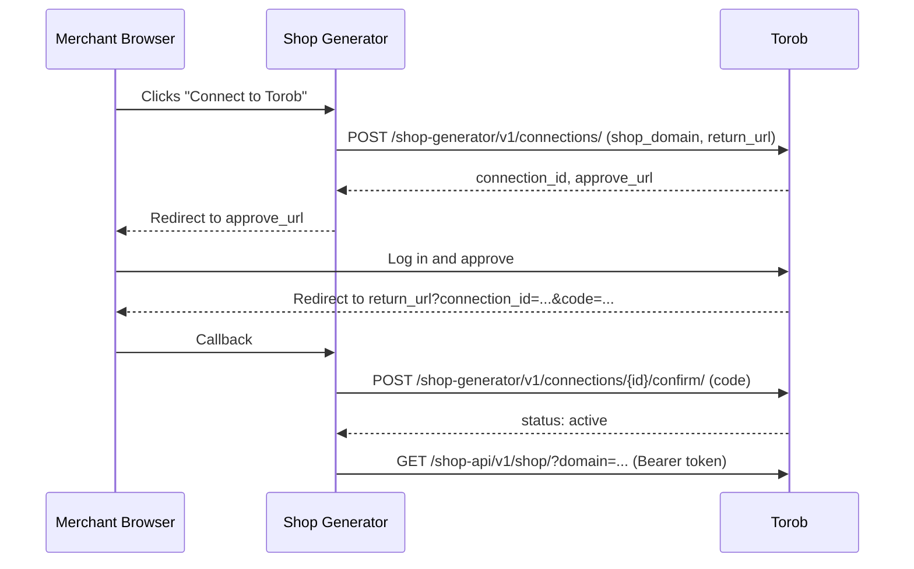

# Shop Generator Connection API

A shop generator (shop builder) calls the [Shop API](shop_api.md) on behalf of the shops on its
platform. Before it can do that for a shop, the shop has to approve it once. This approval is a
**connection**. It lasts until the shop or the shop generator disconnects.

A connection is made in three parts:

1. The shop generator requests a connection for a shop domain and gets back an `approve_url`.
2. The shop generator sends the merchant's browser to `approve_url`. The merchant logs in with their
   Torob account and approves or denies. Torob then redirects the browser to the shop generator's
   `return_url`, with a one-time `code` if the merchant approved.
3. The shop generator confirms the connection with that `code`. The connection is now `active`.

The whole flow must finish within 15 minutes of the request.

The `code` comes back through the merchant's browser, not in the API response. This way, an approval
counts only for the browser session that started it. The shop generator should check that the
`connection_id` in the callback is the one it stored for that browser session. Otherwise, a user of
the platform could add another shop's domain and get the real owner to approve it.

A shop can also disconnect from its Torob shop panel at any time. After that, Shop API calls for
that shop return 403.



## Basics

- **Base URL**: `https://api.torob.com/shop-generator/v1/`
- **Format**: request bodies and responses are JSON.
- **Authentication**: the partner token Torob gave your platform. It only works from your
  registered IP addresses. The same token is used for the Shop API once a shop is connected.

Every request sends these headers:

| Header | Value | Required |
| ------ | ----- | -------- |
| `Authorization` | `Bearer <token>` | Yes |
| `Content-Type` | `application/json` | For requests with a body (`POST`) |

## Endpoints

| Method | Path | Description |
| ------ | ---- | ----------- |
| `POST` | `/connections/` | Request a connection to a shop |
| `GET` | `/connections/{connection_id}/` | Get a connection |
| `POST` | `/connections/{connection_id}/confirm/` | Activate an approved connection |
| `DELETE` | `/connections/{connection_id}/` | Disconnect |

## Connection Object

Every endpoint except `DELETE` returns a connection:

| Field | Type | Description |
| ----- | ---- | ----------- |
| `connection_id` | string, UUID (36 characters, e.g. `75a60226-4997-4ae3-bd10-68f7014e0779`) | Connection ID. A shop generator has one connection per shop, and this ID never changes |
| `shop_domain` | string | The shop's domain as registered on Torob, e.g. `example.ir` |
| `status` | string, one of `pending`, `approved`, `active`, `revoked`, `expired` | The connection's status (below) |
| `approve_url` | string (https URL) or null | The page to send the merchant's browser to. A URL only while `status` is `pending`; `null` otherwise |

| `status` | Meaning |
| -------- | ------- |
| `pending` | Waiting for the merchant to approve |
| `approved` | The merchant approved; waiting for the shop generator to confirm |
| `active` | Connected; the Shop API can be called for this shop |
| `revoked` | The merchant denied, or the shop generator or the shop disconnected |
| `expired` | 15 minutes passed before the connection became active |

## Request a Connection

`POST /shop-generator/v1/connections/`

### Request

Body:

| Field | Type | Required | Description |
| ----- | ---- | -------- | ----------- |
| `shop_domain` | string | Yes | The shop's domain, e.g. `example.ir`. Case and a leading `www.` are ignored |
| `return_url` | string (URL) | Yes | Where the merchant's browser returns after approving or denying. Must be `https`; `http` is accepted only for `localhost` and `127.0.0.1`. It may have its own query parameters |

```http
POST /shop-generator/v1/connections/ HTTP/1.1
Host: api.torob.com
Authorization: Bearer <token>
Content-Type: application/json

{"shop_domain": "example.ir", "return_url": "https://generator.example/torob/callback?merchant=42"}
```

### Response

**200 OK**: a connection object.

| Field | Type | Value |
| ----- | ---- | ----- |
| `connection_id` | string, UUID (36 characters) | The connection's ID; the same as before if this shop was requested earlier |
| `shop_domain` | string | The shop's domain on Torob |
| `status` | string, `pending` or `active` | `pending`: the request is open. `active`: already connected; the connection is returned unchanged |
| `approve_url` | string (https URL) or null | A URL when `status` is `pending`; `null` when `active` |

```json
{
  "connection_id": "75a60226-4997-4ae3-bd10-68f7014e0779",
  "shop_domain": "example.ir",
  "status": "pending",
  "approve_url": "https://api.torob.com/shop-panel/shop-connections/75a60226-4997-4ae3-bd10-68f7014e0779/approve/"
}
```

```json
{
  "connection_id": "75a60226-4997-4ae3-bd10-68f7014e0779",
  "shop_domain": "example.ir",
  "status": "active",
  "approve_url": null
}
```

If the connection is not active, requesting again makes the same connection `pending` again. The
15 minutes start over, the new `return_url` replaces the old one, and a code that was not confirmed
stops working.

**Errors**:

| Status | Field | Type | Value | When |
| ------ | ----- | ---- | ----- | ---- |
| 400 | `error` | string | `invalid request body` | A field is missing or has the wrong type, or `return_url` is not `https` |
| 400 | `detail` | string | `Cannot parse request body (...)` | The body is not valid JSON |
| 404 | `error` | string | `No shop has this domain.` | No shop on Torob has this domain |

```json
{"error": "invalid request body"}
```

```json
{"detail": "Cannot parse request body (Expecting value: line 1 column 1 (char 0))"}
```

```json
{"error": "No shop has this domain."}
```

## Approval Callback

This is not an API call. After the merchant decides on `approve_url`, Torob redirects their browser
to `return_url` with these query parameters added. Parameters already in `return_url` are kept.

| Parameter | Type | Sent when | Description |
| --------- | ---- | --------- | ----------- |
| `connection_id` | string, UUID (36 characters) | Always | The connection |
| `code` | string, 43 characters of `A-Z`, `a-z`, `0-9`, `-`, `_` | Approved | One-time code for confirming, valid until the 15 minutes run out |
| `error` | string, always `denied` | Denied | The merchant denied; the connection is now `revoked` |

Approved:

```
https://generator.example/torob/callback?merchant=42&connection_id=75a60226-4997-4ae3-bd10-68f7014e0779&code=hgx8duhEXiUmcMnxiULEzt-ZccOYFD3pfs-NEXXNeP0
```

Denied:

```
https://generator.example/torob/callback?merchant=42&connection_id=75a60226-4997-4ae3-bd10-68f7014e0779&error=denied
```

There is no redirect if the merchant's Torob account has no access to the shop, if the request has
expired or was already handled, or if the connection does not exist. In these cases the merchant
sees an error on Torob's page.

## Get a Connection

`GET /shop-generator/v1/connections/{connection_id}/`

### Request

Path parameters:

| Parameter | Type | Required | Description |
| --------- | ---- | -------- | ----------- |
| `connection_id` | string, UUID (36 characters) | Yes | The `connection_id` from Request a Connection |

```http
GET /shop-generator/v1/connections/75a60226-4997-4ae3-bd10-68f7014e0779/ HTTP/1.1
Host: api.torob.com
Authorization: Bearer <token>
```

### Response

**200 OK**: a connection object.

| Field | Type | Value |
| ----- | ---- | ----- |
| `connection_id` | string, UUID (36 characters) | The requested connection's ID |
| `shop_domain` | string | The shop's domain on Torob |
| `status` | string, one of `pending`, `approved`, `active`, `revoked`, `expired` | The current status |
| `approve_url` | string (https URL) or null | A URL when `status` is `pending`; `null` otherwise |

```json
{
  "connection_id": "75a60226-4997-4ae3-bd10-68f7014e0779",
  "shop_domain": "example.ir",
  "status": "approved",
  "approve_url": null
}
```

**Errors**:

| Status | Field | Type | Value | When |
| ------ | ----- | ---- | ----- | ---- |
| 400 | `error` | string | `invalid request body` | `connection_id` is not a UUID |
| 404 | `error` | string | `Connection not found.` | There is no such connection, or it belongs to another shop generator |

```json
{"error": "invalid request body"}
```

```json
{"error": "Connection not found."}
```

## Confirm a Connection

`POST /shop-generator/v1/connections/{connection_id}/confirm/`

### Request

Path parameters:

| Parameter | Type | Required | Description |
| --------- | ---- | -------- | ----------- |
| `connection_id` | string, UUID (36 characters) | Yes | The `connection_id` from the approval callback |

Body:

| Field | Type | Required | Description |
| ----- | ---- | -------- | ----------- |
| `code` | string, 43 characters | Yes | The `code` from the approval callback |

```http
POST /shop-generator/v1/connections/75a60226-4997-4ae3-bd10-68f7014e0779/confirm/ HTTP/1.1
Host: api.torob.com
Authorization: Bearer <token>
Content-Type: application/json

{"code": "hgx8duhEXiUmcMnxiULEzt-ZccOYFD3pfs-NEXXNeP0"}
```

### Response

**200 OK**: a connection object; the connection is active.

| Field | Type | Value |
| ----- | ---- | ----- |
| `connection_id` | string, UUID (36 characters) | The confirmed connection's ID |
| `shop_domain` | string | The shop's domain on Torob |
| `status` | string | Always `active` |
| `approve_url` | null | Always `null` |

```json
{
  "connection_id": "75a60226-4997-4ae3-bd10-68f7014e0779",
  "shop_domain": "example.ir",
  "status": "active",
  "approve_url": null
}
```

**Errors**:

| Status | Field | Type | Value | When |
| ------ | ----- | ---- | ----- | ---- |
| 400 | `error` | string | `invalid request body` | `code` is missing, or `connection_id` is not a UUID |
| 400 | `error` | string | `The code is invalid, used or expired.` | The code is wrong or already used, the 15 minutes have passed, or the connection's status is not `approved` (for example, still `pending` or already `active`) |
| 404 | `error` | string | `Connection not found.` | There is no such connection, or it belongs to another shop generator |

```json
{"error": "invalid request body"}
```

```json
{"error": "The code is invalid, used or expired."}
```

```json
{"error": "Connection not found."}
```

## Disconnect

`DELETE /shop-generator/v1/connections/{connection_id}/`

Disconnects an active connection, or cancels a request that is not active yet. The connection's
status becomes `revoked`, and Shop API calls for the shop return 403.

### Request

Path parameters:

| Parameter | Type | Required | Description |
| --------- | ---- | -------- | ----------- |
| `connection_id` | string, UUID (36 characters) | Yes | The connection to disconnect |

```http
DELETE /shop-generator/v1/connections/75a60226-4997-4ae3-bd10-68f7014e0779/ HTTP/1.1
Host: api.torob.com
Authorization: Bearer <token>
```

### Response

**204 No Content**: disconnected. There is no body. Repeating the request also returns 204.

**Errors**:

| Status | Field | Type | Value | When |
| ------ | ----- | ---- | ----- | ---- |
| 400 | `error` | string | `invalid request body` | `connection_id` is not a UUID |
| 404 | `error` | string | `Connection not found.` | There is no such connection, or it belongs to another shop generator |

```json
{"error": "invalid request body"}
```

```json
{"error": "Connection not found."}
```

## Errors on Every Endpoint

| Status | Field | Type | Value | When |
| ------ | ----- | ---- | ----- | ---- |
| 401 | `detail` | string | `Unauthorized` | The token is missing or invalid, or the request came from an IP address the token does not allow |
| 403 | `detail` | string | `Only shop generator tokens can manage shop connections.` | The token is not a shop generator token, for example a shop's own token |

```json
{"detail": "Unauthorized"}
```

```json
{"detail": "Only shop generator tokens can manage shop connections."}
```

## After Connecting

With an `active` connection, the shop generator calls the [Shop API](shop_api.md) with the same
token and sends the shop's domain in the `domain` parameter, for example
`/shop-api/v1/shop/?domain=example.ir`. Every Shop API endpoint is open to shop generators except
charge transfer, which only the shop's own token can use.
