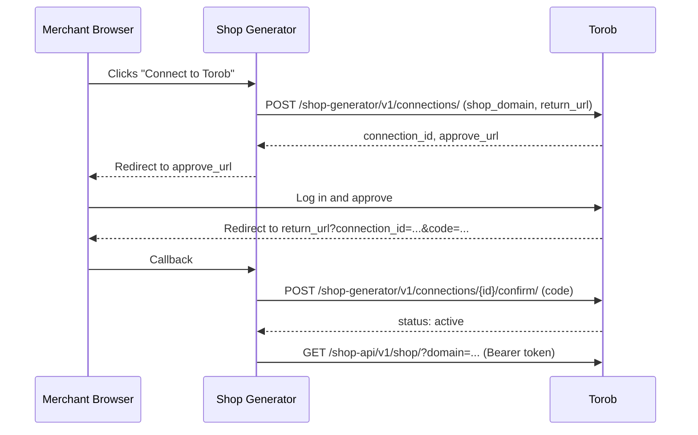

# Shop Generator Connection API

A shop generator (shop builder) calls the [Shop API](shop_api.md) on behalf of the shops on its
platform. Before it can do that for a shop, the shop has to approve it once. This approval is a
**connection**. It lasts until the shop or the shop generator disconnects.

A connection is made in three parts:

1. The shop generator requests a connection for a shop domain and gets back an `approve_url`.
2. The shop generator sends the merchant's browser to `approve_url`. The merchant logs in with their
   Torob account and approves or denies. Torob then redirects the browser to the shop generator's
   `return_url`, with a one-time `code` if the merchant approved.
3. The shop generator confirms the connection with that `code`. The connection is now `active`.

The whole flow must finish within 15 minutes of the request.

The `code` comes back through the merchant's browser, not in the API response. This way, an approval
counts only for the browser session that started it. The shop generator should check that the
`connection_id` in the callback is the one it stored for that browser session. Otherwise, a user of
the platform could add another shop's domain and get the real owner to approve it.

A shop can also disconnect from its Torob shop panel at any time. After that, Shop API calls for
that shop return 403.



## Basics

- **Base URL**: `https://api.torob.com/shop-generator/v1/`
- **Authentication**: the partner token Torob gave your platform, sent as
  `Authorization: Bearer <token>`. It only works from your registered IP addresses. The same token
  is used for the Shop API once a shop is connected.
- **Format**: request bodies and responses are JSON.

## Endpoints

| Method | Path | Description |
| ------ | ---- | ----------- |
| `POST` | `/connections/` | Request a connection to a shop |
| `GET` | `/connections/{connection_id}/` | Get a connection |
| `POST` | `/connections/{connection_id}/confirm/` | Activate an approved connection |
| `DELETE` | `/connections/{connection_id}/` | Disconnect |

## Connection Object

| Field | Type | Description |
| ----- | ---- | ----------- |
| `connection_id` | string (UUID) | Connection ID |
| `shop_domain` | string | The shop's domain on Torob |
| `status` | string | One of the statuses below |
| `approve_url` | string or null | The page to send the merchant's browser to; set only while `pending` |

| Status | Meaning |
| ------ | ------- |
| `pending` | Waiting for the merchant to approve |
| `approved` | The merchant approved; waiting for the shop generator to confirm |
| `active` | Connected; the Shop API can be called for this shop |
| `revoked` | The merchant denied, or the shop generator or the shop disconnected |
| `expired` | 15 minutes passed before the connection became active |

A shop generator has one connection per shop, and its `connection_id` never changes.

## Request a Connection

`POST /shop-generator/v1/connections/`

| Field | Type | Required | Description |
| ----- | ---- | -------- | ----------- |
| `shop_domain` | string | Yes | The shop's domain; case and a leading `www.` are ignored |
| `return_url` | string | Yes | Where the merchant's browser returns after approving or denying. Must be `https`; `http` is accepted only for `localhost` and `127.0.0.1` |

### Request

```http
POST /shop-generator/v1/connections/ HTTP/1.1
Host: api.torob.com
Authorization: Bearer <token>
Content-Type: application/json

{"shop_domain": "example.ir", "return_url": "https://generator.example/torob/callback?merchant=42"}
```

### Responses

**200 OK**: the request is open. Send the merchant's browser to `approve_url`.

```json
{
  "connection_id": "75a60226-4997-4ae3-bd10-68f7014e0779",
  "shop_domain": "example.ir",
  "status": "pending",
  "approve_url": "https://api.torob.com/shop-panel/shop-connections/75a60226-4997-4ae3-bd10-68f7014e0779/approve/"
}
```

**200 OK**: already connected to this shop. The active connection is returned unchanged.

```json
{
  "connection_id": "75a60226-4997-4ae3-bd10-68f7014e0779",
  "shop_domain": "example.ir",
  "status": "active",
  "approve_url": null
}
```

**400 Bad Request**: a field is missing or has the wrong type, or `return_url` is not `https`.

```json
{"error": "invalid request body"}
```

**400 Bad Request**: the body is not valid JSON.

```json
{"detail": "Cannot parse request body (Expecting value: line 1 column 1 (char 0))"}
```

**404 Not Found**: no shop on Torob has this domain.

```json
{"error": "No shop has this domain."}
```

If the connection is not active, requesting again makes the same connection `pending` again. The
15 minutes start over, the new `return_url` replaces the old one, and a code that was not confirmed
stops working.

## Approval Callback

This is not an API call. After the merchant decides on `approve_url`, Torob redirects their browser
to `return_url` with these query parameters added. Parameters already in `return_url` are kept.

| Parameter | Sent when | Description |
| --------- | --------- | ----------- |
| `connection_id` | Always | The connection |
| `code` | Approved | One-time code for confirming, a 43-character string |
| `error` | Denied | Always `denied`; the connection is now `revoked` |

Approved:

```
https://generator.example/torob/callback?merchant=42&connection_id=75a60226-4997-4ae3-bd10-68f7014e0779&code=hgx8duhEXiUmcMnxiULEzt-ZccOYFD3pfs-NEXXNeP0
```

Denied:

```
https://generator.example/torob/callback?merchant=42&connection_id=75a60226-4997-4ae3-bd10-68f7014e0779&error=denied
```

There is no redirect if the merchant's Torob account has no access to the shop, if the request has
expired or was already handled, or if the connection does not exist. In these cases the merchant
sees an error on Torob's page.

## Get a Connection

`GET /shop-generator/v1/connections/{connection_id}/`

### Request

```http
GET /shop-generator/v1/connections/75a60226-4997-4ae3-bd10-68f7014e0779/ HTTP/1.1
Host: api.torob.com
Authorization: Bearer <token>
```

### Responses

**200 OK**: the connection.

```json
{
  "connection_id": "75a60226-4997-4ae3-bd10-68f7014e0779",
  "shop_domain": "example.ir",
  "status": "approved",
  "approve_url": null
}
```

**400 Bad Request**: `connection_id` is not a UUID.

```json
{"error": "invalid request body"}
```

**404 Not Found**: there is no such connection, or it belongs to another shop generator.

```json
{"error": "Connection not found."}
```

## Confirm a Connection

`POST /shop-generator/v1/connections/{connection_id}/confirm/`

| Field | Type | Required | Description |
| ----- | ---- | -------- | ----------- |
| `code` | string | Yes | The `code` from the approval callback |

### Request

```http
POST /shop-generator/v1/connections/75a60226-4997-4ae3-bd10-68f7014e0779/confirm/ HTTP/1.1
Host: api.torob.com
Authorization: Bearer <token>
Content-Type: application/json

{"code": "hgx8duhEXiUmcMnxiULEzt-ZccOYFD3pfs-NEXXNeP0"}
```

### Responses

**200 OK**: the connection is active.

```json
{
  "connection_id": "75a60226-4997-4ae3-bd10-68f7014e0779",
  "shop_domain": "example.ir",
  "status": "active",
  "approve_url": null
}
```

**400 Bad Request**: `code` is missing, or `connection_id` is not a UUID.

```json
{"error": "invalid request body"}
```

**400 Bad Request**: the code is wrong or already used, the 15 minutes have passed, or the
connection is not `approved` (for example, still `pending` or already `active`).

```json
{"error": "The code is invalid, used or expired."}
```

**404 Not Found**: there is no such connection, or it belongs to another shop generator.

```json
{"error": "Connection not found."}
```

## Disconnect

`DELETE /shop-generator/v1/connections/{connection_id}/`

Disconnects an active connection, or cancels a request that is not active yet. The connection's
status becomes `revoked`, and Shop API calls for the shop return 403.

### Request

```http
DELETE /shop-generator/v1/connections/75a60226-4997-4ae3-bd10-68f7014e0779/ HTTP/1.1
Host: api.torob.com
Authorization: Bearer <token>
```

### Responses

**204 No Content**: disconnected. Repeating the request also returns 204.

**400 Bad Request**: `connection_id` is not a UUID.

```json
{"error": "invalid request body"}
```

**404 Not Found**: there is no such connection, or it belongs to another shop generator.

```json
{"error": "Connection not found."}
```

## Errors on Every Endpoint

**401 Unauthorized**: the token is missing or invalid, or the request came from an IP address the
token does not allow.

```json
{"detail": "Unauthorized"}
```

**403 Forbidden**: the token is not a shop generator token, for example a shop's own token.

```json
{"detail": "Only shop generator tokens can manage shop connections."}
```

## After Connecting

With an `active` connection, the shop generator calls the [Shop API](shop_api.md) with the same
token and sends the shop's domain in the `domain` parameter, for example
`/shop-api/v1/shop/?domain=example.ir`. Every Shop API endpoint is open to shop generators except
charge transfer, which only the shop's own token can use.
