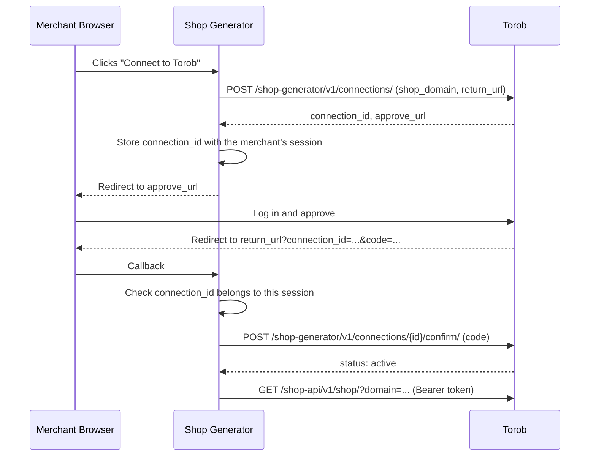

# Connecting a Shop: Shop Generator Guide
## Get a Shop's Approval to Use the Shop API on Its Behalf

This guide is for **shop generators** (shop builders). It explains how to get a shop's approval
before calling the [Shop API](shop_api.md) on its behalf. Shops do not need it.

You need a shop's approval once per shop. It lasts until the shop or you disconnect.

- **Base URL**: `https://api.torob.com/shop-generator/v1/`
- **Content-Type**: `application/json` for request bodies and responses

## 0. Diagram

How a shop generator connects to a shop:



## 1. Authentication

Use the partner token Torob gave your platform, in the `Authorization` header, never in the URL:

```
Authorization: Bearer <token>
```

The token only works from your registered IP addresses. You use the same token for the Shop API
once a shop is connected.

## 2. Steps

1. **Request a connection** from your server with `POST /shop-generator/v1/connections/`. Store the
   returned `connection_id` together with the merchant's session in your system.
2. **Redirect the merchant's browser** to the returned `approve_url`.
3. **The merchant approves on Torob.** They log in with their Torob account, and Torob checks that
   they are a user of the shop. The browser then returns to your `return_url` (section 3).
4. **Check the callback.** The `connection_id` in the callback must be the one you stored for
   **this** browser session. If it is not, stop: the approval belongs to someone else.
5. **Confirm** with `POST /shop-generator/v1/connections/{connection_id}/confirm/` and the `code`.
   Only now is the connection active.

The whole flow, from step 1 to step 5, must finish within 15 minutes.

Step 4 is what stops a merchant on your platform from claiming another shop's domain: the approval
redirect goes to the real owner's browser, not theirs. Do not skip it.

A shop can also revoke your access at any time from its Torob shop panel. After that, Shop API
calls for that shop return 403 until the shop approves a new connection.

## 3. The Callback to `return_url`

After the merchant decides, Torob redirects their browser to your `return_url` and adds these query
parameters. Query parameters already in your `return_url` are kept.

| Parameter | When | Description |
| --------- | ---- | ----------- |
| `connection_id` | Always | The connection; compare it with the one you stored for this browser |
| `code` | Approved | One-time code for `confirm/` (a 43-character string), valid until the 15 minutes run out |
| `error` | Denied | Always `denied`; the connection is `revoked` and there is no `code` |

```
https://generator.example/torob/callback?merchant=42&connection_id=75a60226-4997-4ae3-bd10-68f7014e0779&code=hgx8duhEXiUmcMnxiULEzt-ZccOYFD3pfs-NEXXNeP0
https://generator.example/torob/callback?merchant=42&connection_id=75a60226-4997-4ae3-bd10-68f7014e0779&error=denied
```

In these cases the merchant sees an error on Torob's page and is **not** sent back to `return_url`:

- Their Torob account has no access to the shop.
- The request has expired, or was already approved or denied.
- The connection request does not exist.

So if a merchant never comes back, read the connection's status (section 6), and request a new
connection if it is `expired`.

## 4. Connection Object

Every endpoint except `DELETE` returns this object:

| Field | Type | Description |
| ----- | ---- | ----------- |
| `connection_id` | string (UUID) | Connection identifier |
| `shop_domain` | string | The shop's domain on Torob |
| `status` | string | The connection's status (below) |
| `approve_url` | string or null | Where to send the merchant's browser; set only while `pending` |

| Status | Meaning |
| ------ | ------- |
| `pending` | Waiting for the merchant to approve |
| `approved` | The merchant approved; waiting for your `confirm/` |
| `active` | Connected; you can call the Shop API for this shop |
| `revoked` | The merchant denied the request, or you or the shop disconnected |
| `expired` | 15 minutes passed before the connection became active |

You have one connection per shop, and its `connection_id` never changes: requesting again for the
same shop restarts that same connection.

## 5. `POST /connections/`

Request a connection to a shop.

| Field | Type | Required | Description |
| ----- | ---- | -------- | ----------- |
| `shop_domain` | string | Yes | The shop's domain; case and a leading `www.` do not matter |
| `return_url` | string | Yes | The page on your site the merchant returns to after approving or denying. It must use `https`; plain `http` is accepted only for `localhost` and `127.0.0.1`, for local testing |

```bash
curl --header "Content-Type: application/json" \
     --header "Authorization: Bearer <token>" \
     --request POST \
     --data '{"shop_domain": "example.ir", "return_url": "https://generator.example/torob/callback?merchant=42"}' \
     "https://api.torob.com/shop-generator/v1/connections/"
```

| Status | Body | Meaning |
| ------ | ---- | ------- |
| 200 | Connection object, `pending` | The request is open; send the merchant's browser to `approve_url` |
| 200 | Connection object, `active` | You are already connected to this shop; nothing to do |
| 400 | `{"error": "invalid request body"}` | A field is missing or has the wrong type, or `return_url` is not `https` |
| 400 | `{"detail": "Cannot parse request body (...)"}` | The body is not valid JSON |
| 404 | `{"error": "No shop has this domain."}` | No shop on Torob has this domain |

```json
{
  "connection_id": "75a60226-4997-4ae3-bd10-68f7014e0779",
  "shop_domain": "example.ir",
  "status": "pending",
  "approve_url": "https://api.torob.com/shop-panel/shop-connections/75a60226-4997-4ae3-bd10-68f7014e0779/approve/"
}
```

When you are already connected:

```json
{
  "connection_id": "75a60226-4997-4ae3-bd10-68f7014e0779",
  "shop_domain": "example.ir",
  "status": "active",
  "approve_url": null
}
```

- If the connection is not active (`pending`, `approved`, `revoked`, or `expired`), requesting again
  makes the same connection `pending` again: the 15 minutes start over, the new `return_url`
  replaces the old one, and a `code` that was not confirmed yet stops working.
- An active connection is returned as it is. To start over, disconnect it first.

## 6. `GET /connections/{connection_id}/`

Read a connection's current status, for example when the merchant did not come back to your
`return_url`, or to check whether the shop has disconnected.

```bash
curl --header "Authorization: Bearer <token>" \
     "https://api.torob.com/shop-generator/v1/connections/75a60226-4997-4ae3-bd10-68f7014e0779/"
```

| Status | Body | Meaning |
| ------ | ---- | ------- |
| 200 | Connection object | The connection's current status |
| 400 | `{"error": "invalid request body"}` | `connection_id` is not a UUID |
| 404 | `{"error": "Connection not found."}` | No such connection, or it belongs to another shop generator |

```json
{
  "connection_id": "75a60226-4997-4ae3-bd10-68f7014e0779",
  "shop_domain": "example.ir",
  "status": "approved",
  "approve_url": null
}
```

## 7. `POST /connections/{connection_id}/confirm/`

Activate an approved connection.

| Field | Type | Required | Description |
| ----- | ---- | -------- | ----------- |
| `code` | string | Yes | The `code` parameter from the callback to your `return_url` |

```bash
curl --header "Content-Type: application/json" \
     --header "Authorization: Bearer <token>" \
     --request POST \
     --data '{"code": "hgx8duhEXiUmcMnxiULEzt-ZccOYFD3pfs-NEXXNeP0"}' \
     "https://api.torob.com/shop-generator/v1/connections/75a60226-4997-4ae3-bd10-68f7014e0779/confirm/"
```

| Status | Body | Meaning |
| ------ | ---- | ------- |
| 200 | Connection object, `active` | The connection is active |
| 400 | `{"error": "invalid request body"}` | `code` is missing, or `connection_id` is not a UUID |
| 400 | `{"error": "The code is invalid, used or expired."}` | The code is wrong or already used, the 15 minutes have passed, or the connection is not `approved` (for example, still `pending` or already `active`) |
| 404 | `{"error": "Connection not found."}` | No such connection, or it belongs to another shop generator |

```json
{
  "connection_id": "75a60226-4997-4ae3-bd10-68f7014e0779",
  "shop_domain": "example.ir",
  "status": "active",
  "approve_url": null
}
```

If you get the code error, read the connection's status (section 6): `active` means you are
connected (for example, an earlier confirm of yours went through); `expired` or `revoked` means you
need to request a new connection.

## 8. `DELETE /connections/{connection_id}/`

Disconnect, for example when a merchant leaves your platform. It also cancels a request that was not
approved or confirmed yet.

```bash
curl --header "Authorization: Bearer <token>" \
     --request DELETE \
     "https://api.torob.com/shop-generator/v1/connections/75a60226-4997-4ae3-bd10-68f7014e0779/"
```

| Status | Body | Meaning |
| ------ | ---- | ------- |
| 204 | None | Disconnected; the status is now `revoked`. Repeating the request also gets 204 |
| 400 | `{"error": "invalid request body"}` | `connection_id` is not a UUID |
| 404 | `{"error": "Connection not found."}` | No such connection, or it belongs to another shop generator |

After you disconnect, Shop API calls for that shop return 403. To connect again, start from
section 5.

## 9. Errors on Every Endpoint

| Status | Body | Meaning |
| ------ | ---- | ------- |
| 401 | `{"detail": "Unauthorized"}` | Missing or invalid token, or a request from an IP the token does not allow |
| 403 | `{"detail": "Only shop generator tokens can manage shop connections."}` | The token is not a shop generator token, for example a shop's token |

## 10. After Connecting

Once the connection is `active`, call the [Shop API](shop_api.md) with the same token and send the
shop's domain in the `domain` parameter, for example `/shop-api/v1/shop/?domain=example.ir`.
For a shop without an active connection, the Shop API returns 403. Every Shop API endpoint is open
to shop generators except charge transfer, which only the shop's own token can use.
